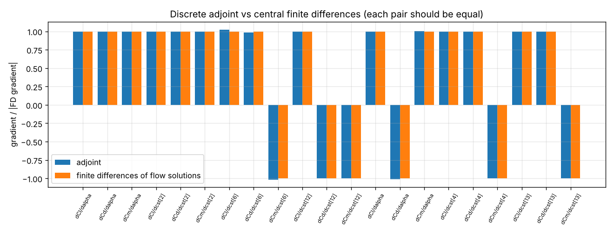
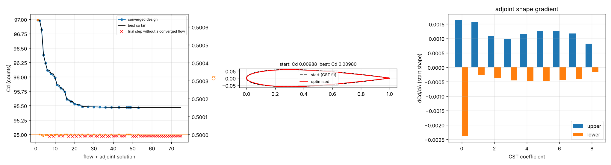

# Discrete adjoint (adjoint.py)

Exact discrete adjoint of the incompressible RANS solver (SIMPLEC / coupled, Spalart-Allmaras, point-vortex far field). The converged state is the root of a residual R(X) that mirrors the solver term by term, with the quantities the solver lags between iterations (Rhie-Chow face fluxes, the skew-corrected Green-Gauss pressure gradient, outlet fluxes, the vortex circulation) as unknowns; dR/dX by coloured complex-step differences (exact to round-off), (dR/dX)^T psi = -dI/dX by sparse LU; design sensitivities (angle of attack, Reynolds number, CST shape coefficients through a mesh deformation that turns the boundary-layer columns with the wall) for one complex residual evaluation each.

## Gradients vs finite differences of complete flow solutions

| case | gradient | adjoint | finite differences (median of 3 steps) | FD spread | rel. difference |
|---|---|---|---|---|---|
| NACA 0012, α 2°, fully turbulent | dCl/dalpha | +1.11598e-01 | +1.11597e-01 | 7.1e-05 | 8.3e-06 |
| NACA 0012, α 2°, fully turbulent | dCd/dalpha | +4.82756e-05 | +4.83290e-05 | 5.6e-03 | 1.1e-03 |
| NACA 0012, α 2°, fully turbulent | dCm/dalpha | +1.20247e-04 | +1.20390e-04 | 1.0e-02 | 1.2e-03 |
| NACA 0012, α 2°, fully turbulent | dCl/dcst[2] | +1.70459e-01 | +1.70459e-01 | 3.1e-06 | 3.1e-06 |
| NACA 0012, α 2°, fully turbulent | dCd/dcst[2] | +9.92135e-04 | +9.92133e-04 | 3.9e-05 | 2.0e-06 |
| NACA 0012, α 2°, fully turbulent | dCm/dcst[2] | +4.77664e-03 | +4.77654e-03 | 1.5e-05 | 2.0e-05 |
| NACA 0012, α 2°, fully turbulent | dCl/dcst[6] | +2.44172e-01 | +2.38171e-01 | 8.7e-02 | 2.5e-02 |
| NACA 0012, α 2°, fully turbulent | dCd/dcst[6] | +9.23476e-04 | +9.36318e-04 | 4.7e-02 | 1.4e-02 |
| NACA 0012, α 2°, fully turbulent | dCm/dcst[6] | -8.68975e-02 | -8.55349e-02 | 5.5e-02 | 1.6e-02 |
| NACA 0012, α 2°, fully turbulent | dCl/dcst[12] | +1.70254e-01 | +1.70243e-01 | 2.0e-04 | 6.1e-05 |
| NACA 0012, α 2°, fully turbulent | dCd/dcst[12] | -8.56526e-04 | -8.56542e-04 | 7.5e-05 | 2.0e-05 |
| NACA 0012, α 2°, fully turbulent | dCm/dcst[12] | -1.80804e-02 | -1.80780e-02 | 4.4e-04 | 1.3e-04 |
| NACA 2412, α 4°, transition fixed 0.25 / 0.6 | dCl/dalpha | +1.13237e-01 | +1.13237e-01 | 3.2e-05 | 2.1e-06 |
| NACA 2412, α 4°, transition fixed 0.25 / 0.6 | dCd/dalpha | -9.04553e-06 | -8.93534e-06 | 2.5e-02 | 1.2e-02 |
| NACA 2412, α 4°, transition fixed 0.25 / 0.6 | dCm/dalpha | +2.15570e-05 | +2.15320e-05 | 3.1e-02 | 1.2e-03 |
| NACA 2412, α 4°, transition fixed 0.25 / 0.6 | dCl/dcst[4] | +1.96242e-01 | +1.96246e-01 | 3.3e-04 | 1.8e-05 |
| NACA 2412, α 4°, transition fixed 0.25 / 0.6 | dCd/dcst[4] | +1.91763e-03 | +1.91756e-03 | 1.3e-04 | 3.5e-05 |
| NACA 2412, α 4°, transition fixed 0.25 / 0.6 | dCm/dcst[4] | -5.50893e-02 | -5.50899e-02 | 2.6e-04 | 1.1e-05 |
| NACA 2412, α 4°, transition fixed 0.25 / 0.6 | dCl/dcst[13] | +1.79877e-01 | +1.79885e-01 | 9.7e-04 | 4.6e-05 |
| NACA 2412, α 4°, transition fixed 0.25 / 0.6 | dCd/dcst[13] | +5.57321e-05 | +5.57395e-05 | 4.3e-03 | 1.3e-04 |
| NACA 2412, α 4°, transition fixed 0.25 / 0.6 | dCm/dcst[13] | -3.71812e-02 | -3.71831e-02 | 1.1e-03 | 5.1e-05 |

Finite differences: central, at three step sizes (alpha 0.02 / 0.05 / 0.1 deg, CST 1e-4 / 2e-4 / 4e-4), each flow re-converged to residuals ~1e-10 on the same mesh topology (shape: the same deformation). The spread column is the scatter of the three: the discretisation has discrete switches (upwind direction, limiter, nearest wall face) that a perturbed solution may cross, which makes a single finite difference uncertain by up to a few per cent for some variables. Where the differences are clean, the adjoint agrees to 1e-5; where they scatter, the adjoint lies within their range. The adjoint itself is exact for the discrete equations: the coloured Jacobian equals a directional complex-step derivative to 1e-16 (tests/test_adjoint.py).

Cost (NACA 0012, level 0.5: 7708 cells, 60034 unknowns, 1368917 Jacobian entries, 214 colours): flow 12 s, Jacobian 19 s, LU 21 s, three adjoint solves 0.4 s, 18 shape gradients 2 s. The LU dominates and grows faster than linearly (level 0.7: ~55 s). MKL PARDISO was tried and rejected: its static pivoting returned wrong solutions on this saddle-point system (pivots over 15 orders of magnitude) even with weighted matching.

## Adjoint design: NACA 0012 -> minimum drag at Cl 0.5, Re 3e6

19 variables (all 18 CST coefficients + alpha), SLSQP inside sequential move limits, every design a deformation of one mesh (level 0.5); 75 flow + adjoint solutions, 41 min.

| | Cd (design mesh) | Cd (re-meshed, level 1, Cl 0.5) |
|---|---|---|
| start (CST fit of NACA 0012) | 0.009698 | 0.009876 |
| optimised | 0.009547 (-1.6 %) | 0.009797 (-0.8 %) |

The design converged after ~25 flow + adjoint solutions (see the history); the trial steps marked x came afterwards, on the plateau: the optimiser sharpens the nose (first CST coefficient: lower +0.025, upper -0.013) and on those shapes the SIMPLEC solver at mesh level 0.5 no longer converges from warm or cold starts, while the deformed mesh stays benign (near-wall lean < 0.7 deg, cell areas > 85 % of the original). Going further needs a more robust flow solver on sharp noses (or a nose-radius constraint), not a different gradient.

Fully turbulent: the drag is mostly friction and the thickness is held (t/c >= 0.119), so the possible gain is small; half of the design-mesh gain survives re-meshing on the validated mesh. Re-meshing every design instead of deforming one mesh made Cd jump by ~3 % between neighbouring designs, which stalls a gradient method; plain inverse-distance deformation leaned the boundary-layer columns at the nose by 1.7° and the explicit non-orthogonal correction then diverged - the deformation now turns the columns with the wall.

## Goal-oriented error estimate (adjoint_error.py): mostly a negative result

Adjoint-weighted residual on the nested fine mesh (every cell split in four, 7726 -> 30904 cells), NACA 0012, α 4°:

| | coarse | fine (solved) | estimate, raw | estimate, 30 smoothing iterations |
|---|---|---|---|---|
| Cl | 0.44218 | 0.43227 | 0.74014 | 0.42235 |
| Cd | 0.00967 | 0.00964 | -0.00049 | 0.00929 |
| Cm | 0.00137 | 0.00343 | -0.06422 | 0.00482 |

Effectivity (estimated / actual error of the coarse value; 1 = exact): Cl 2.00, Cd 11.90, Cm 1.68. Without smoothing the correction is useless (the reconstruction leaves child-to-child residual jumps in the boundary layer that the coarse adjoint weights arbitrarily). After 30 fine-mesh iterations it gets the direction of the lift and moment errors right but overshoots about twice, and it does not estimate the drag error. Even the exact fine-mesh adjoint (240 000 unknowns) did not make the raw correction work (Cl 0.442 -> 0.453 against a fine value of 0.434): the reconstructed state is too far from the fine solution in the nonlinear sense (limiter and SA switches) and the adjoint fields reach 1e5-1e7 at the trailing-edge and wall singularities. This is in line with the experience that the adjoint-weighted residual works far less well for second-order finite-volume RANS than for DG. The cell-wise |psi . R| is kept as an adaptation indicator (adjoint_error.adapt; the mesher's triangle size field takes a multiplier, hybrid_mesher.build_mesh(size_scale=...)), not as a corrected value.

