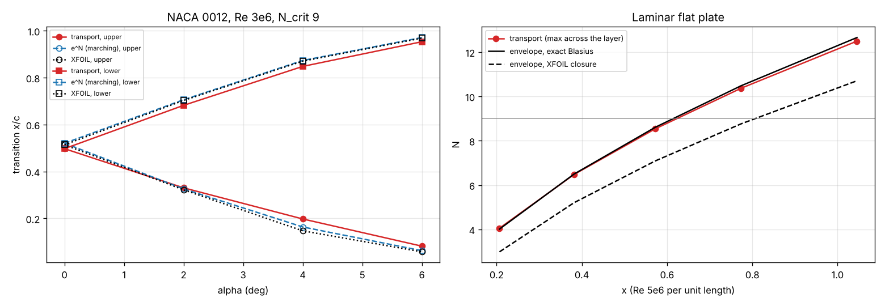

# Amplification-factor transport (aft.py)

The e^N envelope method as two local transport equations on the RANS mesh: D n/Dt = |u| r(H, Re_theta, theta) and D I/Dt = |u| U_e^5 (Thwaites' integral, which carries the boundary-layer history), U_e from the local static pressure, H from Thwaites' lambda (Falkner-Skan anchored at Blasius' 2.591). No surface marching, no boundary-layer integrals. Run with `airfoil.py polar ... --transition aft`.

## Laminar flat plate (Re 5e6 per unit length)

| x | n (transport) | N exact Blasius | N XFOIL closure | Re_theta (transport) | Re_theta Blasius |
|---|---|---|---|---|---|
| 0.207 | 4.06 | 4.01 | 2.99 | 689 | 675 |
| 0.382 | 6.48 | 6.50 | 5.21 | 937 | 917 |
| 0.572 | 8.54 | 8.61 | 7.09 | 1147 | 1123 |
| 0.774 | 10.37 | 10.48 | 8.76 | 1333 | 1306 |
| 1.045 | 12.49 | 12.66 | 10.71 | 1550 | 1518 |

The transported n follows the exact Blasius envelope (the classical e^9 result, Re_x ~ 3e6); XFOIL's laminar closure has H = 2.568 on a flat plate and runs later - the criterion is that sensitive to H (2.591 vs 2.61 alone moves e^9 by 18 %).

## NACA 0012, Re 3e6

| α | x_tr upper: transport / e^N / XFOIL | x_tr lower: transport / e^N / XFOIL | Cd: transport / e^N / XFOIL |
|---|---|---|---|
| 0 | 0.497 / 0.520 / 0.514 | 0.497 / 0.520 / 0.514 | 0.00538 / 0.00515 / 0.0051 |
| 2 | 0.330 / 0.326 / 0.322 | 0.682 / 0.706 / 0.703 | 0.00553 / 0.00544 / 0.0054 |
| 4 | 0.198 / 0.164 / 0.147 | 0.848 / 0.873 / 0.871 | 0.00593 / 0.00605 / 0.0062 |
| 6 | 0.082 / 0.062 / 0.057 | 0.953 / 0.971 / 0.969 | 0.00725 / 0.00734 / 0.0075 |

Development notes (kept because they matter for any local transition model): a purely local closure (each cell's Falkner-Skan state from u/U_e, Re_V and the local pressure gradient) recovers the Blasius layer from single cells but has no history and put transition 0.05-0.07 c early behind the suction peak; transporting Thwaites' integral fixed that. The boundary-layer detector needs three conditions: velocity deficit, rotation (d|Omega|/|u| > 0.2: the decelerating stagnation flow ahead of the nose otherwise looked like a separating layer) and a wall-distance bound (far-field cells with a numerical total-pressure loss otherwise tripped the leading edge). Molecular diffusion of n and I mixed the inner layer with entrained outer fluid (n -11 %); both are path integrals and are now purely advected. Laminar separation bubbles are outside the model (transition.py).

