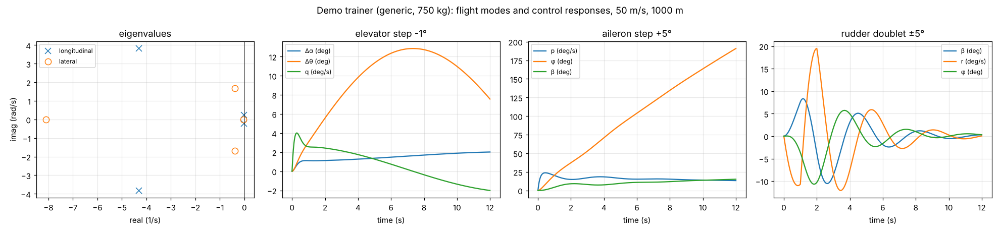
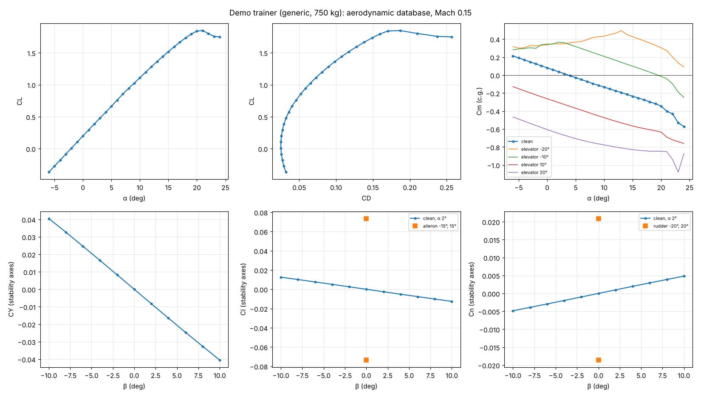
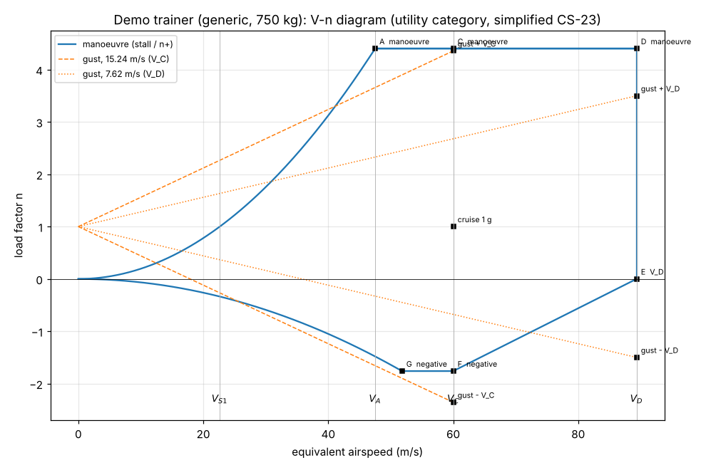
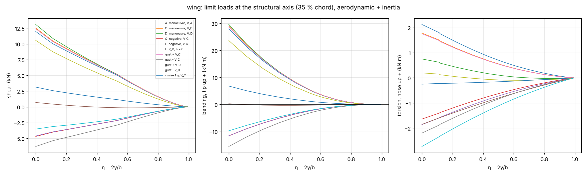
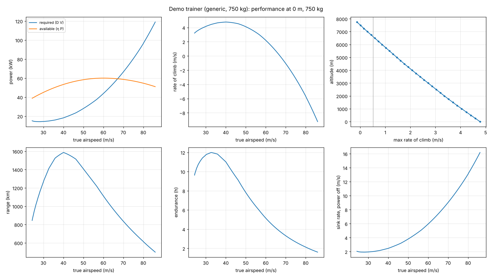

# Aircraft tools: stability and control, aero database, flight loads, performance

Generated by `src/report_aircraft.py` (demo trainer, 750 kg, generic). App pages: Aircraft model, Stability and control, Aero database, Flight loads, Performance.

## Method in one paragraph
One vortex lattice for all lifting surfaces (horseshoe vortices, control-surface hinges and edges on panel edges, sideslip and body rates in the free stream, Kutta–Joukowski forces with the full local velocity), camber, profile drag, section moments and stall from the CFD section polars (decambering on every strip), Munk slender-body fuselage moments and friction drag. Derivatives by central differences; flight modes from the small-perturbation equations; loads by trimming every V–n case and integrating the strip forces with inertia relief; performance from the trimmed nonlinear drag polar and a piston/fixed-pitch propeller model.

## Validation (`validate_aircraft.py`, `aircraft_validation.json`)

Same geometry in AeroSandbox's vortex-lattice method (independent code; symmetric sections, no fuselage, inviscid):

| quantity | AeroLab | AeroSandbox | difference |
|---|---|---|---|
| CL | 0.3160 | 0.3153 | +0.2 % |
| Cm | 0.0374 | 0.0342 | +9.2 % |
| CLa | 5.4063 | 5.3877 | +0.3 % |
| Cma | -2.3553 | -2.3939 | +1.6 % |
| x_np | 2.9337 | 2.9443 | -0.4 % |
| CYb | -0.3146 | -0.3220 | +2.3 % |
| Clb | -0.1011 | -0.1088 | +7.1 % |
| Cnb | 0.1204 | 0.1210 | -0.5 % |
| Clp | -0.5287 | -0.5461 | +3.2 % |

Multi-panel surfaces (kinks): wing with a 2 m constant-chord centre panel and a swept, tapered outer panel with a dihedral break and 3° washout; tail and fin with a kink:

| quantity | AeroLab | AeroSandbox | difference |
|---|---|---|---|
| CL | 0.2600 | 0.2565 | +1.4 % |
| Cm | 0.0580 | 0.0589 | -1.6 % |
| CLa | 5.3949 | 5.3461 | +0.9 % |
| Cma | -1.7877 | -1.7775 | -0.6 % |
| x_np | 2.9580 | 2.9595 | -0.1 % |
| CYb | -0.2732 | -0.2702 | -1.1 % |
| Clb | -0.0999 | -0.1131 | +11.7 % |
| Cnb | 0.0946 | 0.0893 | +6.0 % |
| Clp | -0.5068 | -0.5165 | +1.9 % |

Rate derivatives (AeroSandbox's q and r derivatives use another definition: its CL_q is 1.5 CL_a on a plain high-aspect-ratio wing, where theory gives CL_q = CL_a):

- AR 30 wing pitching about c/4: CL_q 5.769 vs CL_a 5.745 (theory: equal); Cm_q -0.766 vs 2-D −π/4 = -0.785
- fin yaw-rate terms vs tail-volume formulas: CY_r 0.304 vs 0.269, Cn_r -0.121 vs -0.115 (fin only)
- wing alone vs the wing tool (Phase 6): CL 0.4193 vs 0.4158, CDi 0.00664 (near field) vs 0.00670 (Trefftz)
- modes vs approximations: phugoid ζ 0.0695 vs CD/(√2 CL) 0.0652; short period ω_n 6.24 vs 6.43 rad/s, ζ 0.763 vs 0.754
- Lamb's apparent-mass factor (fineness 6): test in `tests/test_aircraft.py`

## Stability and control (demo, 50 m/s, 1000 m)

Trim α 2.27°, elevator +0.88°, CL 0.424, L/D 14.0. Neutral point x 2.582 m, static margin 23.1 % MAC, dε/dα 0.357.

| derivative | value | | derivative | value |
|---|---|---|---|---|
| CL_a | 5.4307 | | CY_b | -0.2401 |
| Cm_a | -1.2565 | | Cl_b | -0.0741 |
| CL_q | 11.3546 | | Cn_b | 0.0295 |
| Cm_q | -20.7083 | | Cl_p | -0.5366 |
| CL_adot | 2.0168 | | Cn_p | -0.0333 |
| Cm_adot | -7.0120 | | Cl_r | 0.1161 |
| CD_a | 0.1628 | | Cn_r | -0.0883 |

| control | CL_δ | Cl_δ | Cm_δ | Cn_δ | CY_δ | Ch_δ | Ch_α |
|---|---|---|---|---|---|---|---|
| aileron | 0.0000 | 0.2858 | -0.0000 | -0.0085 | 0.0443 | -0.829 | 0.382 |
| flap | 1.3276 | -0.0000 | 0.0251 | 0.0000 | -0.0000 | -0.875 | -0.453 |
| elevator | 0.6004 | -0.0000 | -2.0221 | 0.0000 | -0.0000 | -0.841 | -0.279 |
| rudder | 0.0000 | 0.0095 | -0.0001 | -0.0618 | 0.1399 | -0.490 | -0.000 |

| mode | ω_n (rad/s) | ζ | period / time constant (s) | Level 1 (MIL-F-8785C, Class I, Cat. B) |
|---|---|---|---|---|
| short period | 5.760 | 0.749 | 1.65 | yes (damping ratio 0.30 to 2.0) |
| phugoid | 0.231 | 0.053 | 27.26 | yes (damping ratio at least 0.04) |
| dutch roll | 1.727 | 0.227 | 3.74 | yes (ζ ≥ 0.08, ω_n ≥ 0.4 rad/s, ζω_n ≥ 0.15 rad/s) |
| roll | – | – | 0.12 | yes (time constant at most 1.4 s) |
| spiral | – | – | 33.01 | yes (time to double at least 20 s (or stable)) |

## Aero database

682 states (α −6…24° × β −10…10°, elevator, aileron, rudder, flap deflections), nonlinear sections, in 56 s. Files: database.xlsx, jsbsim_aero.xml (complete `<aerodynamics>` section), aircraft.avl + aircraft.mass, CSV/JSON.

## Flight loads (utility category, V_C 60 m/s EAS, 80 kg fuel)

n+ 4.40, n− -1.76; V_S1 22.6, V_A 47.5, V_D 89.3 m/s; gust factor K_g 0.648.

| case | V_EAS (m/s) | n | root shear (kN) | root bending (kN m) | root torsion (kN m) |
|---|---|---|---|---|---|
| A  manoeuvre, V_A | 47.5 | +4.40 | 11.96 | 27.95 | 2.12 |
| C  manoeuvre, V_C | 60.0 | +4.40 | 12.51 | 28.99 | 1.78 |
| D  manoeuvre, V_D | 89.3 | +4.40 | 13.08 | 29.55 | 0.75 |
| G  negative, V_G | 51.8 | -1.76 | -4.70 | -11.59 | -1.64 |
| F  negative, V_C | 60.0 | -1.76 | -4.63 | -11.58 | -1.86 |
| E  V_D, n = 0 | 89.3 | +0.00 | 0.69 | 0.26 | -1.85 |
| gust + V_C | 60.0 | +4.36 | 12.39 | 28.71 | 1.75 |
| gust - V_C | 60.0 | -2.36 | -6.29 | -15.52 | -2.20 |
| gust + V_D | 89.3 | +3.50 | 10.56 | 23.59 | 0.19 |
| gust - V_D | 89.3 | -1.50 | -3.53 | -9.73 | -2.73 |
| cruise 1 g, V_C | 60.0 | +1.00 | 3.13 | 6.80 | -0.25 |

Check: with inertia relief off, the root shear of the half wing equals half the wing's lift (test). 1 g cruise: bending / shear puts the load centroid at ≈ 42 % semi-span (elliptic: 42.4 %).

## Performance (75 kW, fixed-pitch propeller, 80 kg fuel, sea level)

Trimmed CL_max 1.69; polar fit CD0 0.0244, Oswald e 0.83. Stall 23.9 m/s, V_max 67.0 m/s, best climb 4.78 m/s at 40 m/s, service ceiling 6623 m, best glide 16.5, range 1587 km at 40 m/s. Takeoff to 15 m 334 m (ground roll 177 m), landing from 15 m 432 m. Flap CL_max increments: takeoff 0.12 (CFD section polars (Re 2.2e+06)), landing 0.17 (CFD section polars (Re 2.2e+06)).

## Limits
- Vortex lattice: attached flow, no vortex lift; post-stall is strip theory (trend). Wake straight along x.
- Fuselage: Munk slender-body moments; no wing-body lift carry-over, no effect of the wing's vertical position on C_l_β, no propeller slipstream or thrust-line effects.
- Hinge moments from the inviscid lattice (no boundary-layer effect on the control; real values are usually smaller in magnitude).
- Modes: thrust independent of speed, Ixz = 0, inertias estimated unless entered.
- Loads: simplified CS-23 envelope (check the negative-gust and V_D lines against the applicable regulation), symmetric manoeuvres only (no rolling or fin load cases yet).
- Performance: Breguet at constant speed and altitude; flap increments from Raymer unless CFD polars of the flapped section exist.
