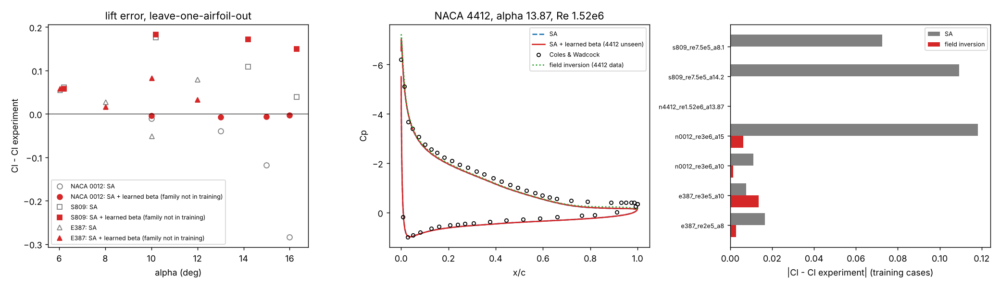

# Field inversion over several airfoils, tested on airfoils left out of training (fiml_multi.py)

The question a reviewer asks of any data-driven turbulence correction: does it carry over to a geometry it was not trained on? Here the SA production multiplier beta(x) is inverted against measured lift and pressure for four airfoil families, a network beta(q) on six local flow features is trained, and each family is predicted by a model that never saw it (leave-one-airfoil-out). Mesh level 0.5 throughout.

## Data (measured only)

| family | Re | data | source |
|---|---|---|---|
| NACA 0012 | 3e6 | lift + upper-surface Cp | Gregory & O'Reilly, NASA R&M 3726 (TMR files) |
| NACA 4412 | 1.52e6 | Cp at alpha 13.87 (trailing-edge separation) | Coles & Wadcock 1979 (TMR, `NACA4412sep_validation`) |
| S809 | 0.75e6 | lift, free transition | Ohio State, NREL/TP-442-7817 (`validation/reference/fiml`) |
| E387 | 2e5, 3e5 | lift, laminar separation bubble | NASA Langley LTPT, TM-4062 |

Not included, and not invented:
- **NACA 2412**: no measured data could be obtained here (Abbott & von Doenhoff exist only as scanned tables).
- **NACA 0012 at Re 6e6 (Ladson)**: the level-0.5 mesh has no converged flow above alpha 7, even with warm-started alpha continuation (alpha 4 converges; the pre-change solver did not converge even that).

The S809 coordinates come from the wall of SU2's S809 test-case mesh: 21.0 % thick at x/c 0.38, as designed.

## Inversions (training data)

| case | Cl SA | Cl inverted | Cl data | Cp RMS SA -> inverted | beta range |
|---|---|---|---|---|---|
| NACA 0012, alpha 10 | 1.0695 | 1.0792 | 1.0807 | 0.131 -> 0.122 | 0.20 - 3.0 |
| NACA 0012, alpha 15 | 1.3870 | 1.4991 | 1.5052 | 0.460 -> 0.299 | 0.20 - 2.61 |
| NACA 4412, alpha 13.87 | 1.6166 | 1.6663 | - | 0.181 -> 0.170 | 0.20 - 3.0 |
| S809, alpha 8.1 | 0.9726 | 0.8999 | 0.900 | - | 0.69 - 1.27 |
| S809, alpha 14.2 | 1.1192 | 1.0097 | 1.010 | - | 0.76 - 1.20 |
| E387, Re 2e5, alpha 8 | 1.1985 | 1.1848 | 1.182 | - | 0.76 - 1.25 |
| E387, Re 3e5, alpha 10 | 1.2585 | 1.2646 | 1.251 | - | 0.95 - 1.36 |

The corrections point in opposite directions:
- **Fully turbulent cases** (NACA 0012, NACA 4412) want more lift near stall. SA separates too early; beta rises in the aft upper boundary layer.
- **Free-transition cases** (S809, E387) want less lift. Here the error comes from the transition model and the laminar bubble; beta drops near the transition region.

The E387 Re 3e5 inversion did not reach its target. Its baseline converges only to about 1e-5 (the bubble flow is not steady to round-off on this mesh), so its adjoint gradient is approximate.

The Cp misfit is the mean over measured points of (Cp_CFD(x_j) - Cp_j)^2. The adjoint gradient of this misfit with respect to beta agrees with central finite differences to 5 digits. An earlier face-weighted misfit was dominated by the dense leading-edge faces and lowered the misfit at the measurements only slightly or not at all.

## Leave-one-airfoil-out predictions

Mean |Cl - Cl data| over the test points of each family, with the model trained on the other families only:

| held-out family | points | SA | SA + learned beta |
|---|---|---|---|
| NACA 0012 (Re 3e6, alpha 10, 13, 15, 16) | 4 | 0.113 | **0.005** |
| E387 (Re 2e5 / 3e5, alpha 6 - 12) | 4 | 0.053 | 0.047 |
| S809 (Re 0.75e6, alpha 6.2 - 16.3) | 4 | 0.096 | 0.141 (worse) |
| NACA 4412 (Cp RMS, alpha 13.87) | 1 | 0.181 | 0.179 |

**NACA 0012: the model generalises.** Trained only on NACA 4412, S809 and E387, it predicts the NACA 0012 lift to within 0.01 up to alpha 16. Baseline SA stalls at alpha 16 (Cl 1.276 against 1.559 measured); the model gives 1.556. The Cp RMS at alpha 15 drops from 0.46 to 0.33. Both NACA 0012 and NACA 4412 fail the same way, by early trailing-edge separation in SA, and the model has learned that physics from the 4412.

**S809: worse.** S809's error is a free-transition error (fully attached flow with too much lift). Only E387 in the training set shares it, and E387 sits at a 3-4 times lower Re. The turbulent-separation correction learned from the NACA cases is applied on top and adds lift.

**NACA 4412: nearly unchanged.** The model barely moves the Cp. The 4412's own inversion also gains little (0.181 -> 0.170). The SA Cp misses the aft upper-surface plateau in a way that a production multiplier alone cannot fix at this alpha. Coles & Wadcock is also a closed-tunnel experiment, run here in free air.

**What it shows for a paper:** a field-inversion correction can carry over to an unseen geometry when the error mechanism is shared (turbulent trailing-edge separation). Mixing mechanisms (transition, laminar bubbles) in one beta field and one feature set hurts the cases where the mechanism differs.

Next steps the results point to:
- Separate corrections, or a feature that tells transitional from turbulent regions (the intermittency is available).
- Pressure data for S809 and E387: the OSU and LTPT reports contain it, but it could not be downloaded here.
- Finer meshes, now affordable with MUMPS.

A model trained on all seven inversions is saved as `cases/fiml_multi/models/all.json`.

Reproduce (about 3 h on 4 cores):

    python src/run.py fiml_multi invert --jobs 3
    python src/run.py fiml_multi loao --jobs 4
    python src/run.py fiml_multi summary
    python src/run.py fiml_multi plot
