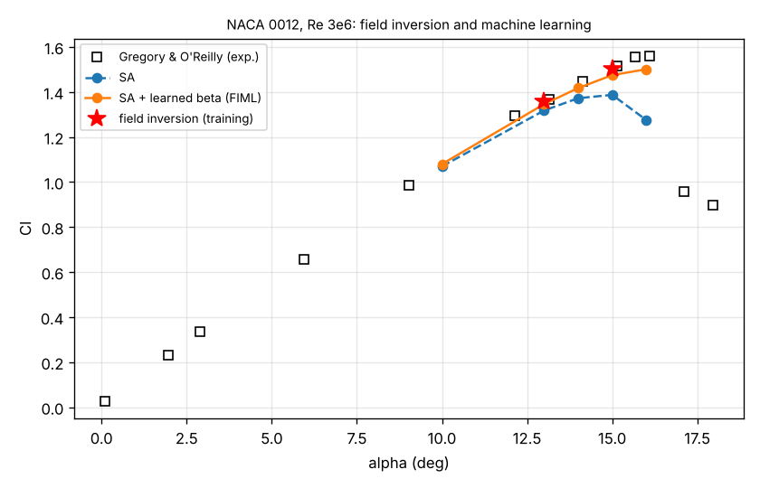

# Field inversion and machine learning (fiml.py)

A multiplier beta(x) on the SA production term, found per training case by adjoint-based optimisation (one adjoint solve per iteration gives the gradient with respect to every cell's beta), then learned as a function of six local flow features by a small neural network and used inside SA for cases not seen in training. NACA 0012, Re 3e6 (mesh level 0.5), lift of Gregory & O'Reilly.

## Inversions (training)

| alpha | Cl SA | Cl target | Cl inverted | flow + adjoint solutions | beta range | cells with abs(beta - 1) > 0.1 |
|---|---|---|---|---|---|---|
| 13 | 1.3176 | 1.3569 | 1.3569 | 29 | 0.581 - 1.368 | 428 of 7702 (96 % upper surface) |
| 15 | 1.3870 | 1.5052 | 1.5051 | 25 | 0.576 - 1.367 | 965 of 7708 (93 % upper surface) |

Where the inversion acts (alpha 13): almost only in the upper-surface boundary layer - mean beta of the corrected cells x/c 0-0.3: 0.94, x/c 0.3-0.7: 1.21, x/c 0.7-1.05: 1.15. Less production near the nose, more over the mid and aft upper surface: more mixing in the adverse pressure gradient, later trailing-edge separation, more lift near stall - the known deficiency of SA there, found from the lift data alone.

## Prediction with the learned model

| alpha | in training | Cl SA | Cl SA + learned beta | Cl experiment | error SA | error learned |
|---|---|---|---|---|---|---|
| 10 | no | 1.0695 | 1.0797 | 1.0807 | -1.0 % | -0.1 % |
| 13 | yes | 1.3176 | 1.3458 | 1.3569 | -2.9 % | -0.8 % |
| 14 | no | 1.3722 | 1.4171 | 1.4365 | -4.5 % | -1.4 % |
| 15 | yes | 1.3870 | 1.4748 | 1.5052 | -7.9 % | -2.0 % |
| 16 | no | 1.2755 | 1.5007 | 1.5592 | -18.2 % | -3.8 % |

The model trained on 13° and 15° improves the lift at every angle, including the unseen 10° and 14° and the 16° beyond the training range, where baseline SA stalls early (-18 %) and the augmented model keeps the flow attached (-4 %). The training angles are not reproduced exactly (the network is a smooth fit of two beta fields).

Limits: two training angles of one airfoil at one Reynolds number, a coarse mesh (the inversion also absorbs discretisation error), lift only. It demonstrates the pipeline; a transferable correction needs inversions over several airfoils and flow conditions (and pressure data: Inversion(cp=...) supports it).

