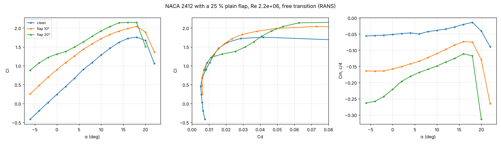

# Plain-flap sections (CFD)

Geometry: `airfoil_geom.deflect_flap` (spec `naca2412@flap=25c20`): camber line rotated aft of the hinge at 75 % chord, smooth 4 %-chord sealed-hinge blend, chord reference unchanged. Inviscid check (panel method): ΔCl = 1.06–1.09 × thin-airfoil flap theory for 5–30° (`tests/test_flap.py`).

RANS (Spalart–Allmaras, e^N transition), Re 2.2e+06:

| flap | ΔCl at α 0 | thin airfoil 2πτδ | ratio (viscous effectiveness) | Cl_max | ΔCl_max | Raymer ΔCl_max | α at Cl_max |
|---|---|---|---|---|---|---|---|
| 10° | 0.654 | 0.668 | 0.98 | 2.040 | +0.285 | 0.225 | 18° |
| 20° | 1.065 | 1.336 | 0.80 | 2.147 | +0.392 | 0.450 | 16° |

Clean section: Cl_max 1.755 at 18°.

The viscous lift increment falls below thin-airfoil theory as the deflection grows (boundary layer on the flap's upper surface), the usual plain-flap behaviour; the performance tool uses these CFD Cl_max increments for takeoff and landing when the polars exist.

Validated range: 0–20°. At 25° the lift at α 0 is already lower than at 20° (flow separated on the flap) and cold starts at higher angles diverge; at 30° no angle converged, also after widening the hinge blend (mesh non-orthogonality 58° → 44°) and with coarse-mesh sequencing. Larger deflections need a slotted-flap model (multi-element tool) or unsteady RANS.

