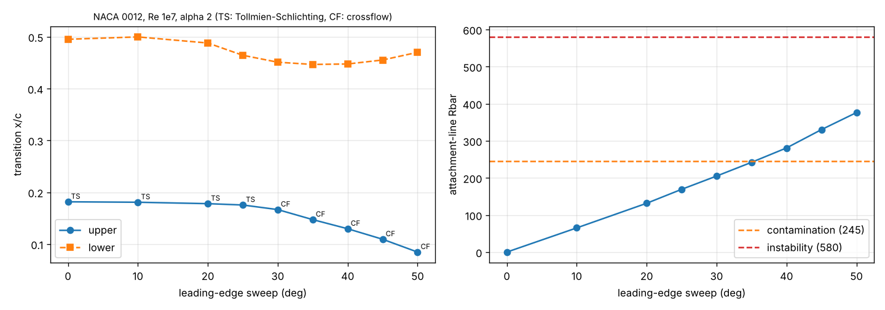

# Swept-wing transition (swept_transition.py, wing.py --transition-3d)

Infinite swept wing, independence principle: attachment line (Poll's Rbar; contamination 245, instability 580), crossflow (Falkner-Skan-Cooke profile matched to the integral layer's shape factor; chi = w_cf,max delta_10 / nu, transition at 200), Tollmien-Schlichting (e^N on the chordwise layer, N_crit from Tu by Mack). Checks (tests/test_swept_transition.py): Blasius / Hiemenz similarity values, no crossflow at zero pressure gradient (g = f' exactly), Rbar of a swept circular cylinder against the exact formula, the unswept wing reproduces the 2D e^N result.

## Sweep study: NACA 0012, Re 1e7 (normal chord), alpha 2°

| sweep | Rbar | upper | mechanism | lower | mechanism | max chi (upper) |
|---|---|---|---|---|---|---|
| 0 | 0 | 0.182 | Tollmien-Schlichting (e^N) | 0.495 | Tollmien-Schlichting (e^N) | 0 |
| 10 | 65 | 0.181 | Tollmien-Schlichting (e^N) | 0.500 | Tollmien-Schlichting (e^N) | 362 |
| 20 | 132 | 0.178 | Tollmien-Schlichting (e^N) | 0.488 | crossflow | 700 |
| 25 | 169 | 0.175 | Tollmien-Schlichting (e^N) | 0.464 | crossflow | 860 |
| 30 | 205 | 0.167 | crossflow | 0.451 | crossflow | 984 |
| 35 | 242 | 0.147 | crossflow | 0.447 | crossflow | 1104 |
| 40 | 281 | 0.130 | crossflow | 0.447 | crossflow | 1192 |
| 45 | 330 | 0.109 | crossflow | 0.455 | crossflow | 1244 |
| 50 | 376 | 0.085 | crossflow | 0.470 | crossflow | 1276 |



## Along a wing: 30° quarter-chord sweep, taper 0.3, Re_MAC 1e7, alpha 3°

```
Transition along the span (leading-edge sweep 32.9 deg; N_crit 9.00; laminar wetted fraction ~31 %)
  eta        Re  a_eff  Rbar  x_tr up mechanism                    x_tr lo mechanism
 0.02  1.38e+07   2.06   244    0.145 crossflow                      0.443 crossflow
 0.40  1.01e+07   2.37   214    0.139 crossflow                      0.487 crossflow
 0.72  6.95e+06   2.29   178    0.163 crossflow                      0.509 crossflow
 0.92  5.03e+06   1.88   147    0.209 crossflow                      0.499 crossflow
 1.00  4.21e+06   0.28   126    0.351 crossflow                      0.391 crossflow
```

The root attachment line sits at Rbar ~ 245, the contamination limit: with turbulence from a fuselage junction (`--contaminated`) the whole inboard wing is turbulent from the leading edge - the reason swept laminar wings need a Gaster bump or a Krueger flap at the root.

